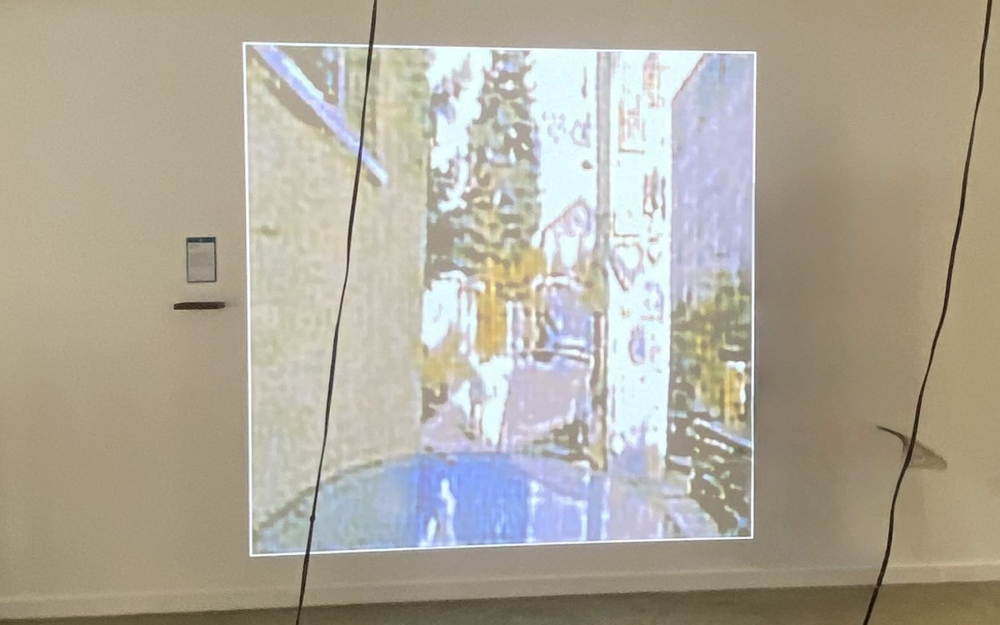
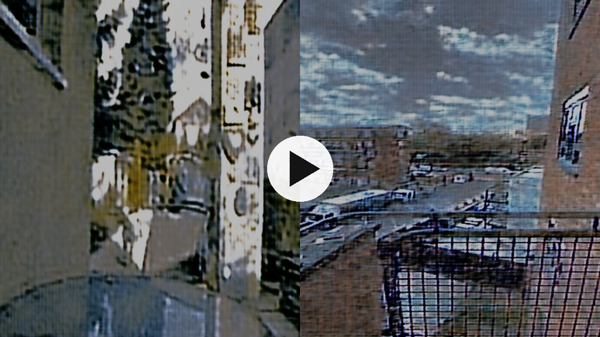
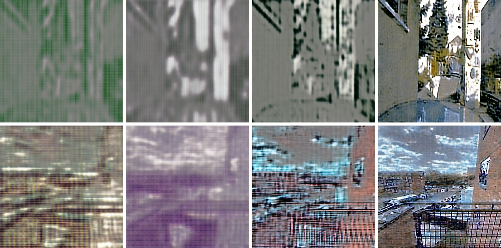
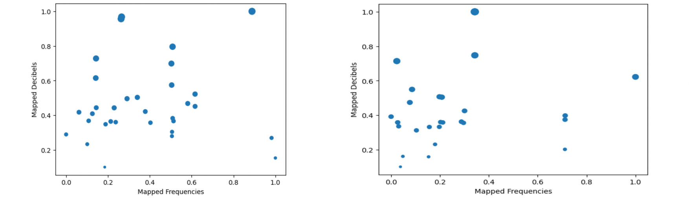
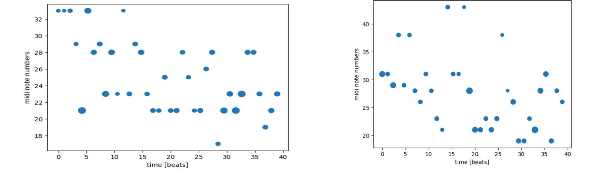

# Which Home?

**An audiovisual installation about memory and migration, built with GANs and sonified field recordings.**

A video of GAN-generated frames drifts from Bucharest to London, while two pieces of music built from field recordings of each city play alongside it. The blurred frames show how memories of a home distort over time, and the sound shows how a place can be called back by the recordings that remind us of it.

   
  <em>The video as shown in the exhibition. Visitors listened on headphones, one pair for each city.</em>

Made as my graduation project for BSc Creative Computing at the University of the Arts London (2023).

## Demo

*Click the image to watch the video on YouTube.*

## The idea

Immigrants often lose parts of their memory of home over time, and with it a part of their identity. This installation uses the tools themselves to express that. GAN training gives frames that are abstract and unclear at first and clearer later, which stands in for memories that blur. The sound works the other way: a recording of a place can bring back details that were forgotten. I used my own photos and recordings from the two places I call home.

### Visual: two GANs

- A GAN was trained for each city on about 1,500 of my own photos. I started with around 600 and kept adding batches until the outputs were clear enough to read but still had some mystery.
- Each training saved over 800 outputs, so I could structure the video myself. The early, abstract outputs carry the feeling of distortion, and the later, clearer ones show the place coming into focus.
- About 320 frames were chosen and placed in order at 0.2 seconds each, moving from Bucharest through a blurred, overlapping middle to London.
- Running the trainings myself meant I could change the code and see its effect on the textures, so I could pick the version whose look matched the idea.

   
  <em>Selected GAN outputs. Top row: Bucharest. Bottom row: London. Each row goes from blurred to clear.</em>

### Sound: field recordings turned into melodies

1. **Recording.** About 20 field recordings in each city, 10 to 20 seconds long, taken at different times of day and week to capture different sides of each place.
2. **Analysis.** `pydub` and `numpy` extract the highest frequency, the lowest frequency, and their decibel values from every recording. The data for each city goes into its own CSV.
3. **Normalising.** The frequency values are normalised in a Jupyter notebook, one notebook per city.
4. **Mapping to notes.** The highest and lowest frequencies of each recording are mapped to the nearest note in **D melodic minor**, and the decibel level sets the **velocity** of the note. That gives about 40 notes per melody, in the order of the recordings, at 90 BPM and 30 seconds long.
5. **Export.** `MIDIutil` exports the notes as MIDI. They are raised by an octave to make them easier to listen to.
6. **Production.** In Logic Pro X, the MIDI is played on piano with piano chords and a bass line built from the same data, and the original field recordings are layered underneath so the source of the notes stays audible.

   
  <em>Frequency against decibel level for the recordings. Left: Bucharest. Right: London. Bigger dots are louder.</em>

   
  <em>The resulting notes over time. Left: Bucharest. Right: London. Bigger dots are louder notes.</em>

### Putting it together

The video is about one minute long. The Bucharest melody plays over the Bucharest GAN frames and the London melody over the London frames. In the exhibition it was heard on two pairs of headphones, which gives a more intimate listening experience than speakers.

## Repository

| File | Contents |
|------|----------|
| `bucharest_GAN.ipynb`, `london_GAN.ipynb` | GAN training for each city |
| `sonifying_data_bucharest.ipynb`, `sonifying_data_london.ipynb` | Turning the audio data into notes and MIDI |
| `convet_to_wav.py` | Audio file conversion |
| `scientific_buc.py`, `scientific_ldn.py` | Audio analysis for each city |

## Built with

Python, PyTorch, NumPy, pydub, MIDIUtil, Jupyter, Logic Pro X, iMovie.

## Author

Daria Cotocu · [dariacotocu.com](https://dariacotocu.com)
